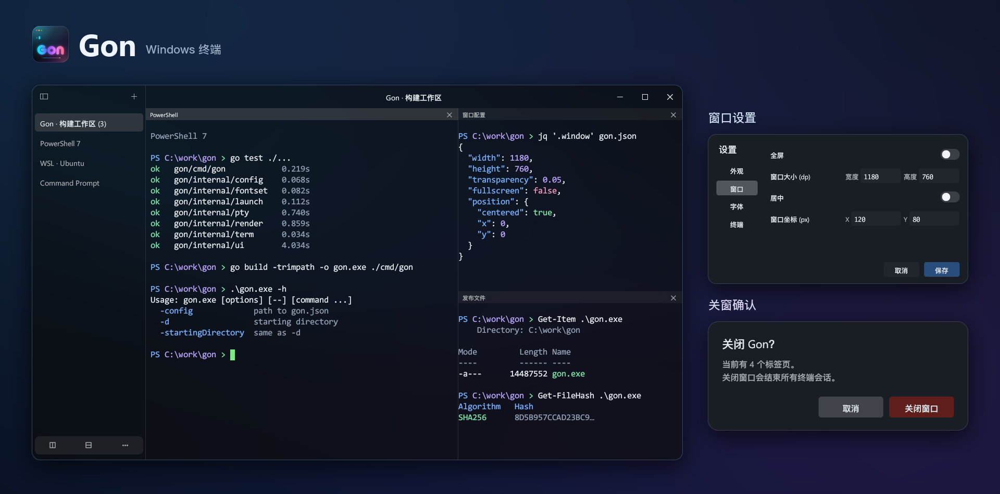

# Gon

纯 Go + [Gio](https://gioui.org) 实现的原生 Windows 终端，**没有 webview、没有 cgo**。
直接调用 Win32 ConPTY 与 D3D11，界面全部自绘。



## 功能

- **左侧多标签页**。默认标签显示启动目录名和程序名，例如 `gon · powershell`。程序只报告启动目录或自身名称时，侧栏也会采用这个格式。按住标签可拖动排序。当前会话以管理员权限运行时，顶部标题旁显示盾牌。焦点窗格的自定义 OSC 标题会同步到侧栏和顶部，保留 CLI 自带的状态字符和动画。分屏时显示窗格数量，悬停可查看权限、完整标签、启动目录及原始标题或程序路径。
- **关窗确认**。窗口中还有标签页时会显示标签页数量。选择 **取消** 或按 `Esc` 可以继续使用当前会话。
- **平铺分屏**。窗口有空间时可继续新增窗格。将标题栏或底部栏拖到同一标签的其他窗格可交换位置。拖动分隔线或竖直分隔线底部的把手可调整两侧尺寸。鼠标靠近窗格右上角时显示 ×，点击关闭后相邻窗格自动补位。
- **跨标签分屏**。将侧栏中已有的标签拖到终端区域，预览会显示标签名和分屏方向，松开完成分屏。也可以右键标签，选择在当前标签右侧或下方显示。把窗格的底部栏拖到另一个标签可交换两个标签的位置。点击窗格或按 `Alt+方向键` 切换输入焦点。右键分屏中的标签选择 **单独显示此标签**，会话继续运行。
- **ConPTY 终端**支持 VT/ANSI 颜色、备用屏幕、同步刷新、焦点和鼠标上报、括号粘贴、OSC 标题与 OSC 52 剪贴板。
- **字体渲染**。`x/image/vector` 光栅化字形，按批上传图集的已用区域。支持粗体、斜体、下划线、删除线、宽字符和 HiDPI，按需加载 CJK 回退字体。
- **外观**。无边框全幅终端、自定义标题栏、Windows 窗口透明度、壁纸磨砂和 DWM 窗口样式。
- **回滚与选择**：可配置回滚行数，滚轮回看历史（可拖动滚动条），拖选 / 双击选词 / 三击整行，复制粘贴，`Ctrl+点击` 打开链接。
- **光标**。支持 DECSCUSR 的方块、竖线和下划线。仅焦点窗格显示光标，窗口失焦或空闲 5 秒后光标停止闪烁。
- **配置化**：shell 列表、默认 shell、字体、窗口、主题、壁纸全部通过 JSON 配置。

## 构建

需要 Go 1.24+ 与 Windows 10 1809 以上（ConPTY）。

Windows x64 构建内置微软的 ConPTY `1.26.261109003-preview`，运行时从应用的用户缓存启动。其他架构使用系统 ConPTY。 [微软发布页](https://github.com/microsoft/terminal/releases/tag/v1.26.3133.0)

```powershell
git clone <repo> gon
cd gon
go build -trimpath -ldflags "-H windowsgui -s -w" -o gon.exe ./cmd/gon
```

构建会把从 [`gon-icon.svg`](gon-icon.svg) 生成的多尺寸图标嵌入 `gon.exe`。修改 SVG 后，可导出为 512 × 512 的透明 PNG，再从项目根目录更新图标资源。

```powershell
go run github.com/tc-hib/go-winres@v0.3.3 simply --arch amd64,arm64,386 --out cmd/gon/gon --manifest none --icon gon-icon.png --file-description Gon --product-name Gon --original-filename gon.exe
```

直接运行：

```powershell
.\gon.exe
# 指定配置文件
.\gon.exe -config D:\cfg\gon.json
```

`-d`（也可写作 `--startingDirectory`）指定启动目录。命令名后面的参数传给子进程。下面的 PowerShell 命令会启动 Claude Code 并设置标签页标题。

```powershell
$env:MY_CC_TITLE = 'Claude Code'
$command = @'
$host.UI.RawUI.WindowTitle = $env:MY_CC_TITLE
claude.exe
'@
.\gon.exe -d . pwsh.exe -NoLogo -NoExit -Command $command
```

直接启动其他终端程序时也可以使用 `.\gon.exe -d . codex.exe`。指定程序而省略 `-d` 时，目录取此次启动所在的位置。只传 `-d` 时会打开配置中的默认 Shell。分屏时会用当前标签页打开时的程序、命令行参数、工作目录和环境变量启动新的终端进程。

## 配置

首次运行使用 `%AppData%\gon\gon.json`。升级时，如果新默认目录尚未创建，Gon 会导入已有的默认配置和字体。可通过 `GON_CONFIG` 或 `-config` 指定其他路径。完整示例见 [`gon.example.json`](gon.example.json)。

从左侧栏底部的 **···** 菜单打开 **设置**。可调整壁纸、背景、终端字体、界面字体、默认 Shell 和启动标签数。保存会写回当前配置文件。

在 **终端 → Shell 配置** 中可添加、编辑和删除 Shell。填写程序名或绝对路径，按需填写显示名称、参数和启动目录。参数使用字符串数组，例如 `["--login", "-i"]`。返回终端页可选择默认 Shell，点击 **保存** 后即可从侧栏菜单启动。

在 **外观** 页拖动 **窗口透明度** 可以即时预览。默认 5%，调到 0% 时窗口完全不透明。

在 **窗口** 页可以输入宽度和高度，或开启 **全屏**。开启 **居中** 会把窗口放在显示器工作区中央。关闭 **居中** 后可输入左上角的 X、Y 坐标，副屏可使用负坐标。全屏时位置用于选显示器。点击 **保存** 后立即应用，下次启动也会使用保存的设置。

在 **终端** 页启用 **单窗口启动** 并保存。此后，同一 Windows 会话和权限级别中使用同一配置文件启动时，Gon 会在已有窗口打开一个标签页并激活该窗口。窗口最小化时会自动恢复。每次启动的参数和环境变量随请求传给该标签。从界面新建的标签使用窗口首次启动时的环境。

在 **字体** 页分别打开 **终端字体** 和 **界面字体** 下拉框。选择带「下载」的预设，下载完成后点击 **保存**。预设包含 JetBrains Mono、MeowSans、Caskaydia Cove、Fira Code 和 Hack Nerd Font，以及 Source Code Pro。字体与许可证保存在配置文件旁的 `fonts` 目录，默认路径为 `%AppData%\gon\fonts`。也可以通过 **字体目录** 打开该目录，加入自己的 `.ttf`、`.otf` 或 `.ttc` 文件，再重新打开下拉框选择。

```json
{
  "shells": [
    { "name": "PowerShell", "command": "pwsh.exe", "args": ["-NoLogo"] },
    { "name": "Command Prompt", "command": "cmd.exe" },
    { "name": "WSL", "command": "wsl.exe" }
  ],
  "default_shell": 0,
  "startup_tabs": 1,
  "single_window": false,
  "scrollback": 8000,
  "cursor_blink_ms": 530,
  "font": {
    "family": "Cascadia Mono",
    "size": 15,
    "line_height": 1.05,
    "cjk_fallback": ["msyh.ttc", "simhei.ttf", "simsun.ttc"]
  },
  "interface_font": {
    "family": "",
    "size": 13
  },
  "window": {
    "width": 1180,
    "height": 760,
    "fullscreen": false,
    "position": { "centered": true, "x": 0, "y": 0 },
    "transparency": 0.05,
    "opacity": 0.82,
    "blur": 36,
    "sidebar_width": 210,
    "padding": 10
  },
  "theme": {
    "background": "#0b0f14",
    "foreground": "#e6edf3",
    "cursor": "#7ee787",
    "selection": "#3f6ea8",
    "accent": "#4c9aff",
    "panel": "#0e131a"
  },
  "wallpaper": ""
}
```

| 字段 | 说明 |
| --- | --- |
| `shells` | “新建标签页”菜单中的 Shell 列表。`command` 可以是可执行文件名或绝对路径。自定义 Shell 的默认标签使用配置的 `name`，留空时取可执行文件名 |
| `default_shell` | 默认 shell 在 `shells` 中的下标 |
| `startup_tabs` | 启动时打开的标签数（1–9） |
| `single_window` | 重复启动时在同一配置的已有窗口打开一个标签页，默认关闭 |
| `scrollback` | 回滚缓冲区行数（0–200000） |
| `font.family` | 终端字体，支持 `app:` 开头的应用字体相对路径、现有的字体族名称和绝对路径 |
| `font.size` | 字号（dp），会按 DPI 缩放 |
| `font.cjk_fallback` | 主字体缺字时使用的 CJK 字体文件名 |
| `interface_font.family` | 独立的界面字体，留空时跟随终端 |
| `interface_font.size` | 界面基准字号（10–18 dp） |
| `window.width` / `window.height` | 窗口宽高（dp），默认 1180 × 760，最小 560 × 360，会按显示器工作区调整 |
| `window.fullscreen` | 启动时进入全屏，默认关闭 |
| `window.position` | `centered` 默认开启。关闭后使用 `x` / `y` 桌面像素坐标 |
| `window.transparency` | 整个窗口的透明度 0–0.8，默认 0.05 |
| `window.opacity` | 壁纸遮罩不透明度 0.2–1.0（0.82 ≈ 约 18% 壁纸透出） |
| `window.blur` | 磨砂强度；壁纸会按此模糊，0 关闭模糊 |
| `window.sidebar_width` | 侧栏宽度（dp） |
| `window.padding` | 标题栏和侧栏的内边距（dp） |
| `wallpaper` | 壁纸图片路径，支持 PNG/JPEG/GIF；留空使用渐变背景 |

## 快捷键

| 快捷键 | 功能 |
| --- | --- |
| `Ctrl+Shift+T` | 新建标签页 |
| `Ctrl+Shift+W` | 关闭当前窗格（只剩一个时关闭标签） |
| `Ctrl+Tab` / `Ctrl+Shift+Tab` | 切换标签页 |
| `Alt+Shift++` / `Alt+Shift+-` | 向右 / 向下分屏 |
| `Alt+Shift+W` | 关闭当前窗格 |
| `Alt+方向键` | 在当前显示的窗格之间移动焦点，支持跨标签 |
| `Ctrl+Shift+C` | 复制选中文本 |
| `Ctrl+C` | 有选中文本时复制，否则发送 `^C` |
| `Ctrl+Shift+V` / `Ctrl+V` | 粘贴文本。Claude Code 和 Codex 可直接粘贴 Windows 剪贴板中的图片 |
| `Ctrl+Shift+F` | 打开历史搜索。支持编辑、粘贴和鼠标导航。`Enter` 查找下一个匹配行，`Shift+Enter` 查找上一个，`Esc` 关闭。 |
| `Ctrl+=` / `Ctrl+-` / `Ctrl+0` | 放大 / 缩小 / 重置字号 |
| `F11` | 全屏切换 |

左键单击聚焦窗格，拖动选区，双击选词，三击选行。滚轮向上或拖动右侧滚动条可回看历史。右键在有选区时复制，无选区时粘贴。`Ctrl+点击` 打开链接。应用开启鼠标跟踪时可按住 `Shift` 在终端内选中文本。

终端接收 Windows 输入法确认后的文本，候选窗口跟随当前窗格的光标。窗口启动时会按显示器的可用工作区自动调整尺寸。

## 结构

| 包 | 职责 |
| --- | --- |
| `internal/config` | JSON 配置的读写与校验 |
| `internal/term` | 屏幕缓冲、VT/ANSI 解析、调色板、按键/鼠标编码 |
| `internal/pty` | ConPTY 会话（Win32 直调，无 cgo），带异步写入与退出检测 |
| `internal/fontset` | 系统字体索引、样式变体、CJK 回退 |
| `internal/render` | 字形图集与 GPU 绘制、文本测量 |
| `internal/ui` | 窗口、主题、标题栏、侧栏、分屏、输入与剪贴板 |
| `cmd/gon` | 程序入口 |

设计细节见 [`PLAN.md`](PLAN.md)。

## 测试

```powershell
go test ./...
```

测试覆盖 VT 解析、按键编码、ConPTY 端到端（真实启动 `cmd.exe` 并校验回显）、
字形光栅化、无头 GPU 渲染（离屏截图校验像素）、分屏几何与配置读写。

渲染截图（需要 GPU，输出 PNG 供人工检查）：

```powershell
$env:GON_SHOT = "shot.png"; go test ./internal/ui -run TestSaveScreenshot -v
```

## 已知限制

- ConPTY 需要 Windows 10 1809 及以上；更早系统无法启动 shell。
- 磨砂由应用内的壁纸模糊和半透明面板共同实现。
- 目前只支持 Windows（`internal/pty` 的平台实现仅 Windows）。
